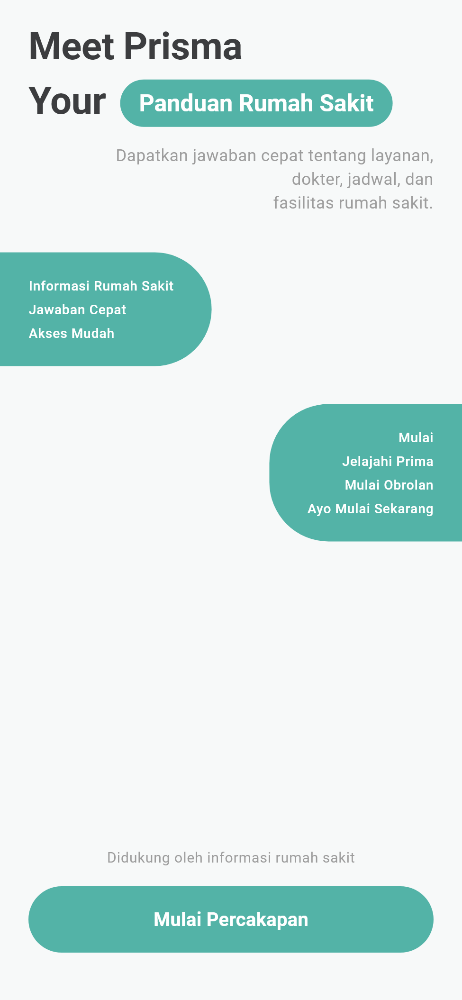
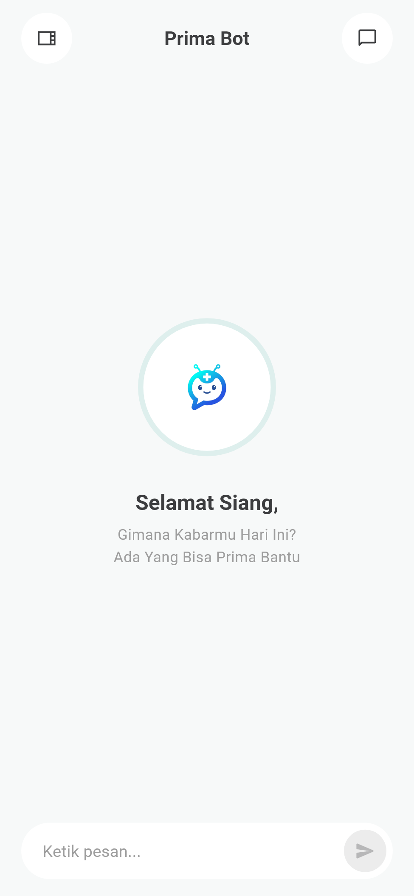
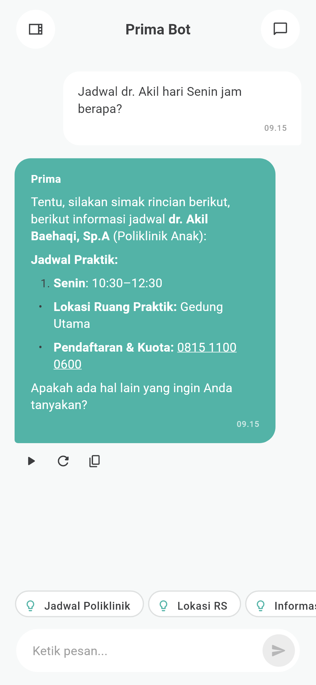
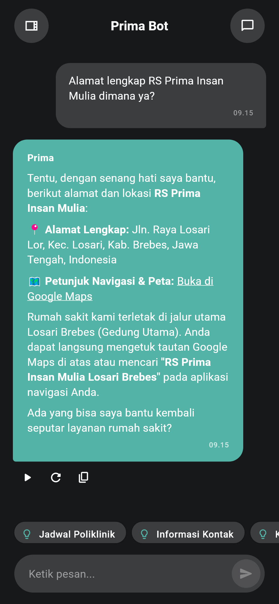
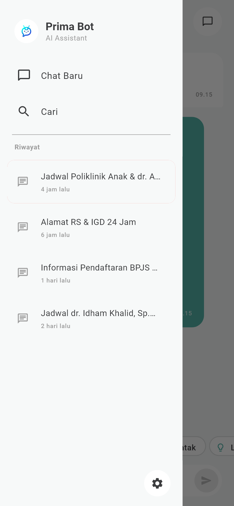
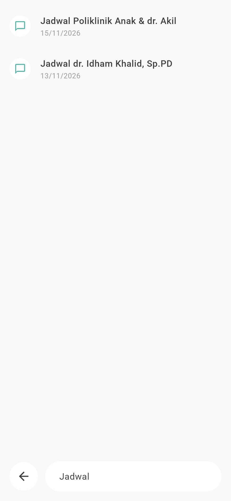
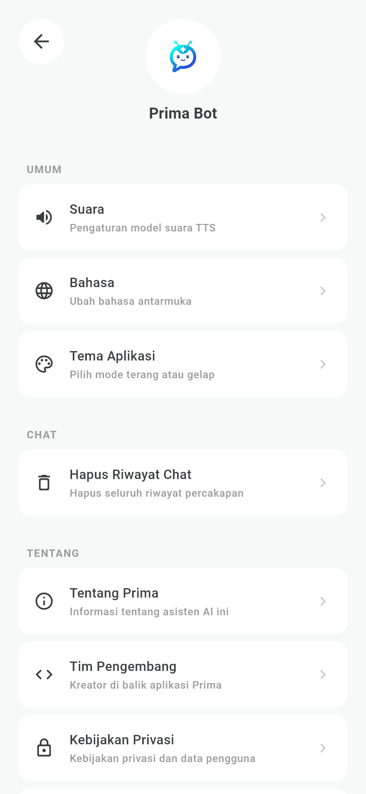
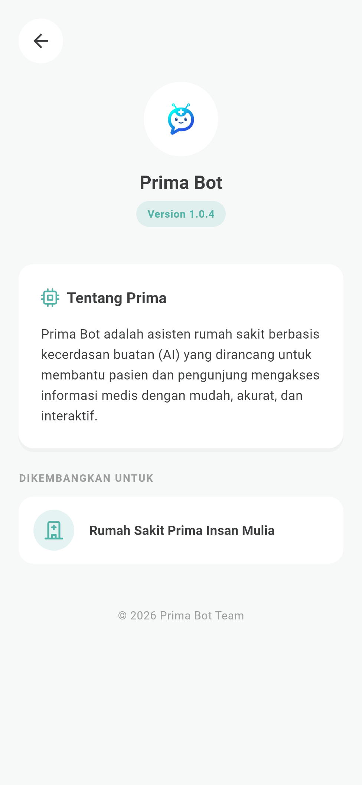
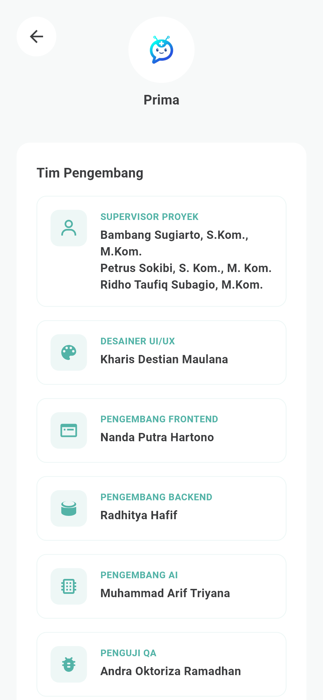
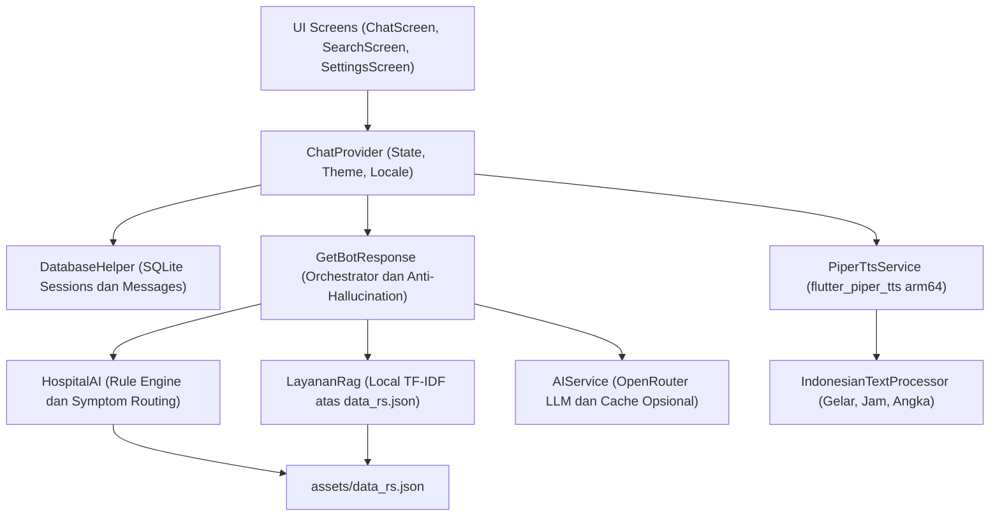

<div align="center">
  
  <h1>PrimaBot</h1>
  <p><strong>Asisten Virtual Cerdas &amp; Ramah untuk Layanan Informasi RS Prima Insan Mulia</strong></p>

  <p>
    
    
    
    
    
  </p>
</div>

---

## Tentang Proyek

**PrimaBot** adalah aplikasi mobile asisten virtual berbasis Flutter untuk **Rumah Sakit Prima Insan Mulia** (`Jln. Raya Losari Lor, Kec. Losari, Kab. Brebes, Jawa Tengah, Indonesia`). Aplikasi ini dirancang untuk membantu pasien, keluarga pasien, dan pengunjung mendapatkan informasi jadwal praktik dokter, daftar poliklinik, kontak darurat/pendaftaran, panduan persiapan berobat, hingga skrining keluhan awal menuju poli yang sesuai.

Untuk menjaga akurasi informasi medis-administratif dan ketersediaan layanan tanpa ketergantungan penuh pada internet, PrimaBot menggabungkan **mesin aturan deterministik lokal (`HospitalAI`)**, **mesin pencarian RAG lokal (`LayananRag` / TF-IDF)** di atas `assets/data_rs.json`, **penghalusan jawaban AI opsional via OpenRouter (`AIService`)** dengan filter anti-halusinasi, serta **Text-to-Speech neural on-device (`PiperTtsService`)** khusus Bahasa Indonesia.

### Informasi & Kontak Resmi Rumah Sakit

| Layanan / Kanal | Detail Resmi |
| :--- | :--- |
| **Nama Instansi** | RS Prima Insan Mulia |
| **Alamat** | Jln. Raya Losari Lor, Kec. Losari, Kab. Brebes, Jawa Tengah, Indonesia |
| **Pendaftaran & Informasi** | `0815 1100 0600` |
| **IGD (24 Jam)** | `0856 4507 7831` |
| **Humas & Pengaduan** | `0856 4507 7830` |
| **Call Center** | `0283 847 3333` |
| **Email** | `primainsan2021@gmail.com` |
| **Unit Layanan Terdata** | Poliklinik Anak, Bedah, Kandungan, Penyakit Dalam, Poli Umum, dan Poli VCT (Gedung Utama) |

---

## Fitur Utama

- **Arsitektur Hybrid AI & Grounding Anti-Halusinasi**
  - **`HospitalAI`**: Pemroses lokal cepat untuk sapaan, profil RS, lokasi, daftar poli, rute keluhan/gejala (termasuk prioritas khusus keluhan anak agar tepat masuk ke Poliklinik Anak), jadwal dokter per nama/hari/poli, dan penanganan poli yang belum tersedia pada data saat ini.
  - **`LayananRag`**: Pengindeksan TF-IDF lokal atas 6 poliklinik dan 23 slot jadwal praktik di `assets/data_rs.json` dengan pembobotan n-gram, token jam terstruktur, dan deteksi maksud pengguna.
  - **`AIService` + `GetBotResponse`**: Integrasi opsional OpenRouter dengan caching, penyaringan tag safety, validasi anti-halusinasi nama dokter serta nomor telepon resmi, dan fallback otomatis ke jawaban lokal tanpa menampilkan pesan kegagalan AI ke pengguna.
- **Neural Text-to-Speech (TTS) Offline via Piper**
  - Menggunakan model `id_ID-news_tts-medium` (`onnx`) yang dibundel di perangkat via `flutter_piper_tts` (`third_party/dart_piper_tts` berbasis Rust `ort` / ONNX Runtime).
  - **`IndonesianTextProcessor`**: Menormalisasi tanda baca, singkatan medis dan gelar dokter (`Sp.A`, `Sp.B`, `Sp.OG`, `Sp.PD`), format jam (`WIB`), rentang angka, tanggal, dan menghindari pengulangan kata seperti `jam jam` agar pelafalan Bahasa Indonesia terdengar alami.
- **Pengalaman Percakapan Lengkap**
  - Efek pengetikan respons bertahap (`typewriter`), salin pesan, edit pesan lalu regenerasi jawaban, regenerate respons bot, pemutaran suara per pesan, dan chip saran pertanyaan lanjutan.
  - Dukungan tautan interaktif Markdown yang aman untuk skema `https`, `http`, `tel`, dan `mailto`.
- **Manajemen Riwayat & Personalisasi**
  - Penyimpanan sesi dan pesan lokal berbasis SQLite (`sqflite`) beserta penamaan judul percakapan otomatis (`ConversationTitleFormatter`), ganti nama sesi, hapus sesi, dan pencarian riwayat realtime (`SearchScreen`).
  - Dukungan tema **Light / Dark / System** (`ThemeProvider`), lokalisasi **Bahasa Indonesia & English** (`LocaleProvider` via `flutter_localizations`), menu pengaturan suara & pratinjau TTS, halaman **Tentang**, dan halaman **Tim Pengembang**.

---

## Tampilan Aplikasi (Screenshots)

### Alur Utama & Percakapan

<table>
  <tr>
    <td align="center" width="33%">
      <br />
      <sub><strong>1. Splash &amp; Onboarding</strong><br/>Tampilan pembuka aplikasi</sub>
    </td>
    <td align="center" width="33%">
      <br />
      <sub><strong>2. Layar Awal Chat (Light)</strong><br/>Saran cepat &amp; identitas PrimaBot</sub>
    </td>
    <td align="center" width="33%">
      <br />
      <sub><strong>3. Percakapan Aktif (Light)</strong><br/>Jadwal dokter, tautan telepon &amp; kontrol TTS</sub>
    </td>
  </tr>
</table>

### Mode Gelap, Navigasi Riwayat & Pencarian

<table>
  <tr>
    <td align="center" width="33%">
      <br />
      <sub><strong>4. Percakapan Mode Gelap</strong><br/>Tampilan gelap dengan peta &amp; kontak</sub>
    </td>
    <td align="center" width="33%">
      <br />
      <sub><strong>5. Drawer &amp; Riwayat Chat</strong><br/>Sesi tersimpan SQLite &amp; akses cepat</sub>
    </td>
    <td align="center" width="33%">
      <br />
      <sub><strong>6. Pencarian Realtime</strong><br/>Filter percakapan berdasarkan kata kunci</sub>
    </td>
  </tr>
</table>

### Pengaturan, Informasi & Tim Pengembang

<table>
  <tr>
    <td align="center" width="33%">
      <br />
      <sub><strong>7. Menu Pengaturan</strong><br/>Bahasa, tema, TTS &amp; informasi aplikasi</sub>
    </td>
    <td align="center" width="33%">
      <br />
      <sub><strong>8. Tentang PrimaBot</strong><br/>Versi rilis, profil RS &amp; lisensi</sub>
    </td>
    <td align="center" width="33%">
      <br />
      <sub><strong>9. Tim Pengembang</strong><br/>Dosen pembimbing &amp; anggota tim</sub>
    </td>
  </tr>
</table>

---

## Arsitektur Sistem



### Alur Kerja Singkat
1. Pengguna mengirim pesan dari `ChatScreen` ke `ChatProvider`.
2. `ChatProvider` menyimpan pesan ke SQLite via `DatabaseHelper` dan memperbarui judul sesi jika masih baru.
3. `GetBotResponse` mengevaluasi pertanyaan melalui `HospitalAI` dan `LayananRag` (`assets/data_rs.json`). Jika `OPENROUTER_API_KEY` aktif pada `.env`, jawaban dapat diperkaya oleh `AIService` lalu diperiksa ulang dengan guard anti-halusinasi (validasi nama dokter & nomor telepon) sebelum dikembalikan ke UI.
4. Ketika pengguna menekan tombol putar suara atau mode suara aktif, `IndonesianTextProcessor` menormalisasi teks agar siap dibaca oleh `PiperTtsService` menggunakan model lokal `id_ID-news_tts-medium.onnx`.

---

## Struktur Direktori

```text
Prima-Bot-main/
├── android/                        # Konfigurasi Gradle, AndroidManifest (<queries> link/tel/mailto), NDK arm64
├── assets/
│   ├── data_rs.json                # Knowledge base lokal (6 poliklinik, 23 slot jadwal praktik)
│   ├── icons/                      # Ikon vektor SVG untuk UI, peran tim, dan kategori info
│   ├── images/                     # Logo PrimaBot, splash, dan launcher icon
│   └── piper/                      # Model TTS offline (id_ID-news_tts-medium.onnx + .onnx.json)
├── docs/
│   └── screenshots/                # Dokumentasi visual layar aplikasi (01..09 PNG)
├── lib/
│   ├── main.dart                   # Entrypoint aplikasi, dotenv, seeder DB, init Piper TTS
│   ├── l10n/                       # File ARB & hasil generate lokalisasi (ID & EN)
│   ├── services/
│   │   ├── hospital_ai.dart        # Engine deterministik profil RS, rute keluhan & jadwal dokter
│   │   ├── rag_service.dart        # Pencarian RAG TF-IDF lokal berbasis data_rs.json
│   │   ├── indonesian_text_processor.dart # Normalisasi teks Indonesia untuk pelafalan TTS
│   │   ├── piper_tts_service.dart  # Manajemen engine & pemutaran audio Piper on-device
│   │   └── piper_voice_catalog.dart # Katalog revisi aset suara Piper yang dibundel
│   └── chatbot_rs/
│       ├── theme.dart              # Konfigurasi tema Light/Dark & tipografi
│       ├── data/                   # Datasources (AI, SQLite, Seeder) & models (jadwal, layanan)
│       ├── domain/                 # Usecases (GetBotResponse, GenerateConversationTitle) & formatter
│       ├── presentation/           # Providers (Chat, Theme, Locale) & widget animasi
│       └── screens/                # Splash, Chat, Search, Settings, & Settings Detail Screens
├── test/
│   ├── bugfixes_and_ai_test.dart   # Unit & widget test perbaikan bug, AI/RAG/TTS, & UI responsiveness
│   ├── chatbot_test.dart           # Pengujian inti chatbot
│   └── widget_test.dart            # Pengujian widget dasar
├── third_party/
│   ├── android_libcpp_shared/      # Hook packaging libc++_shared untuk native assets Android
│   └── dart_piper_tts/             # Binding Rust (ort/ONNX Runtime) & Piper TTS untuk Dart/Flutter
├── l10n.yaml                       # Konfigurasi flutter gen-l10n
└── pubspec.yaml                    # Dependensi, asset, & dependency_overrides lokal
```

---

## Prasyarat & Cara Build (Android arm64)

> [!IMPORTANT]
> Paket lokal `third_party/dart_piper_tts` menggunakan crate Rust `ort` (ONNX Runtime) dan konfigurasi `android/app/build.gradle.kts` menargetkan ABI **`arm64-v8a`** (`ndkVersion = "28.2.13676358"`). Oleh karena itu perintah build Android **wajib** memakai flag `--target-platform android-arm64`.

### 1. Prasyarat Lingkungan Pengembangan
1. **Flutter SDK 3.47+** & **Dart 3.13+**.
2. **Rust Toolchain** (`rustup`) dengan target Android arm64 terpasang:
   ```bash
   rustup target add aarch64-linux-android
   ```
3. **Android NDK `28.2.13676358`** beserta environment variable agar hook `android_libcpp_shared` menemukan NDK yang tepat:
   - `ANDROID_NDK_HOME=C:\MAD\android\Sdk\ndk\28.2.13676358`
   - `ANDROID_NDK_ROOT=C:\MAD\android\Sdk\ndk\28.2.13676358`
4. **Konfigurasi Opsional `.env`** (jangan pernah commit `.env` ke Git):
   Jika ingin mengaktifkan pengayaan jawaban OpenRouter di atas jawaban lokal RAG, buat file `.env` di root proyek:
   ```env
   OPENROUTER_API_KEY=your_openrouter_api_key_here
   ```
   Tanpa `.env` atau tanpa kunci API, aplikasi tetap berjalan normal sepenuhnya secara lokal menggunakan `HospitalAI` + `LayananRag` + `PiperTtsService`.
5. *Catatan Windows*: Jika perintah `flutter` macet tanpa output, hapus file lock usang `flutter/bin/cache/lockfile` atau `flutter.bat.lock`.

### 2. Menjalankan Analisis & Pengujian

```bash
flutter pub get
flutter analyze
flutter test
```

### 3. Build APK & App Bundle (AAB)

```bash
# Debug APK (untuk pengujian langsung di perangkat Android arm64)
flutter build apk --debug --target-platform android-arm64

# Release APK (output: build/app/outputs/flutter-apk/app-release.apk)
flutter build apk --release --target-platform android-arm64

# Release Android App Bundle / AAB (output: build/app/outputs/bundle/release/app-release.aab)
flutter build appbundle --release --target-platform android-arm64
```

> [!NOTE]
> Build pertama kali akan mengompilasi crate Rust (`ort`, dsb.) sehingga memakan waktu sekitar 15-30 menit; build berikutnya memanfaatkan cache dan jauh lebih cepat. Saat ini `buildTypes.release` pada `android/app/build.gradle.kts` memakai `signingConfigs.getByName("debug")` untuk kebutuhan testing & distribusi internal; sebelum unggah ke Google Play Store, tambahkan konfigurasi release keystore khusus milik instansi.

---

## Ringkasan Perbaikan & Peningkatan (v1.0.4)

Perbaikan berikut diterapkan tanpa menghapus fitur yang sudah ada:

- **Integritas Database & State Chat**:
  - Memperbaiki query SQL `sanitizeSessionTitles` pada `local_datasource.dart` yang sebelumnya kehilangan parameter `whereArgs: [sessionId]`.
  - Memperbaiki sinkronisasi state `_isLoading` dan penanganan `StateError` di `ChatProvider` ketika sesi dihapus saat respons sedang diproses, serta memastikan pembaruan saran (`_suggestions`) memicu `_safeNotify()`.
- **Akurasi AI, RAG & Anti-Halusinasi**:
  - Memperbaiki regex tokenisasi jam pada `LayananRag` (`replaceAllMapped` menggantikan literal `'$1 $2'`).
  - Memperketat validator `_berhalusinasi` pada `GetBotResponse` (deteksi nama dokter diawali `dr.` secara akurat dan validasi panjang nomor telepon resmi rumah sakit) serta menjaga format baris baru/bullet di `_bersihkanMentah`.
  - Memperbaiki pencocokan nama dokter pada `DokterData.cariNama` dengan batas kata (`\b`), memperluas deteksi sapaan & hari (`jum'at`, wrapping hari), memprioritaskan keluhan anak ke **Poliklinik Anak** sebelum aturan pencernaan dewasa, dan memperjelas jawaban untuk poli yang belum tersedia dalam jadwal RS saat ini.
- **Pelafalan TTS Bahasa Indonesia**:
  - Memperbaiki `IndonesianTextProcessor` untuk gelar spesialis bertitik (`Sp.A`, `Sp.B`, `Sp.OG`, `Sp.PD`), deduplikasi `Kandungan, Obsgyn`, validasi waktu `HH,MM`, penghapusan duplikasi `jam jam` / `pukul jam`, dan pembersihan awalan `'jam '` berulang pada output jadwal TTS.
  - Memperbaiki `SoundSettingsScreen` agar dapat memicu inisialisasi ulang model Piper ketika belum siap alih-alih tertahan di status persiapan.
- **UI, Aksesibilitas & Konfigurasi Android**:
  - Memperbaiki overflow teks kanan pada pill *"Panduan Rumah Sakit"* di `ChatbotSplashScreen` untuk layar selebar 390px.
  - Memperbaiki kontras tombol *Batal* saat edit pesan di Light Mode, menambahkan pembungkus `Material` pada item drawer agar tidak memicu assertion `ColoredBox`, mendukung pembukaan tautan `https`, `http`, `tel`, dan `mailto` (termasuk `<queries>` pada `AndroidManifest.xml`), serta mengekstrak `_RenameSessionDialog` agar `TextEditingController` ter-dispose bersih.

---

## Tim Pengembang & Pembimbing

Berdasarkan kredit resmi di dalam aplikasi (**Halaman Pengembang**):

### Dosen Pembimbing (Project Supervisors)
- **Bambang Sugiarto, S.Kom., M.Kom.**
- **Petrus Sokibi, S. Kom., M. Kom.**
- **Ridho Taufiq Subagio, M.Kom.**

### Tim Pengembang
| Peran | Nama |
| :--- | :--- |
| **UI/UX Designer** | Kharis Destian Maulana |
| **Frontend Developer** | Nanda Putra Hartono |
| **Backend Developer** | Radhitya Hafif |
| **AI Developer** | Muhammad Arif Triyana |
| **QA Tester** | Andra Oktoriza Ramadhan |

---

<div align="center">
  <sub>&copy; 2026 Prima Bot Team &bull; RS Prima Insan Mulia, Losari - Brebes</sub>
</div>
